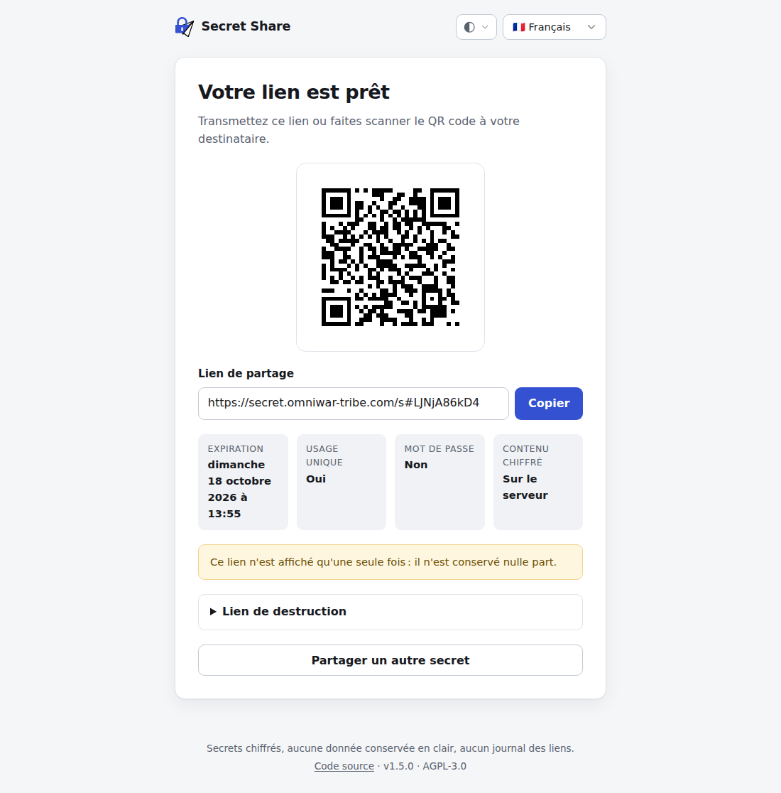

# Secret Share

Partagez un mot de passe, une clé d'API ou toute information sensible au moyen d'un
**lien éphémère et chiffré**, accompagné d'un **QR code**.

- Chiffrement XChaCha20-Poly1305, mot de passe optionnel protégé par Argon2id
- **Clé partagée** : ni le lien seul, ni le serveur seul ne permettent de lire le secret
- **Usage unique** (par défaut) et **durée de validité** de 10 minutes à 1 an
- **Lien de destruction** remis au créateur pour révoquer le secret à tout moment
- **Sans trace** : le jeton voyage dans le fragment de l'URL (`#…`), jamais envoyé
  au serveur, donc absent de tous les journaux HTTP ; aucune IP, date de création
  ou métadonnée n'est conservée
- **Protection contre les abus** : limitation de débit par visiteur sans stocker d'adresse IP,
  quotas de stockage, ressources bornées ; déblocage manuel par `./unblock.sh`
- Interface sobre, responsive, accessible, thème clair/sombre automatique, en **9 langues**
  (dont l'arabe, écrit de droite à gauche) avec sélecteur de langue
- Image Docker durcie : utilisateur non privilégié, système de fichiers en lecture seule




## Démarrage rapide

Prérequis : Docker avec le plugin Compose.

```bash
git clone https://github.com/ludeus/secret-share.git
cd secret-share
./install.sh --url https://secret.example.org --port 8765
docker compose up -d
```

`install.sh` crée le fichier `.env` (droits `600`) à partir de `.env.dist` et génère une clé
`APP_SECRET` aléatoire. La base SQLite est créée automatiquement au premier démarrage, dans
le volume Docker `data`.

L'application écoute alors sur `127.0.0.1:8765`, à placer derrière un reverse proxy HTTPS
(voir plus bas).

### Sans cloner le dépôt

```bash
docker run -d --name secret-share \
  -e APP_SECRET="$(openssl rand -base64 48)" \
  -e APP_URL=https://secret.example.org \
  -p 127.0.0.1:8765:8080 \
  -v secret-share-data:/app/data \
  --read-only --tmpfs /tmp \
  --tmpfs /var/run/apache2:uid=33,gid=33 --tmpfs /var/lock/apache2:uid=33,gid=33 \
  --cap-drop ALL --security-opt no-new-privileges \
  ludeus/secret-share:latest
```

Conservez la valeur d'`APP_SECRET` : la changer rend illisibles tous les secrets en cours.

### Mise à jour

```bash
git pull                      # scripts et docker-compose.yml à jour
docker compose pull           # nouvelle image (IMAGE dans .env, par ex. ludeus/secret-share:1.2.2)
docker compose up -d
```

Le schéma de la base est mis à jour automatiquement au démarrage et les secrets en cours sont
conservés. Les nouvelles variables de `.env.dist` ont toutes une valeur par défaut. Les
fichiers statiques étant versionnés par leur date de modification, les navigateurs
rechargent d'eux-mêmes ceux qui ont changé.

## Configuration

Toute la configuration se fait par variables d'environnement (fichier `.env` avec Compose).
Une valeur invalide empêche le conteneur de démarrer, avec un message explicite.

| Variable                | Défaut                  | Description                                                              |
|-------------------------|-------------------------|--------------------------------------------------------------------------|
| `APP_SECRET`            | *(obligatoire)*         | Clé maître, 32 caractères minimum (`openssl rand -base64 48`)            |
| `APP_URL`               | *(obligatoire)*         | URL publique, sans slash final ; sert à construire les liens             |
| `APP_BIND`              | `127.0.0.1`             | Adresse d'écoute sur l'hôte (Compose)                                    |
| `APP_PORT`              | `8765`                  | Port d'écoute sur l'hôte (Compose)                                       |
| `SHORT_CODE_LENGTH`     | `10`                    | Longueur des URL courtes (8 à 64 caractères, ≈ 5,8 bits chacun)          |
| `SECRET_MAX_LENGTH`     | `10000`                 | Taille maximale d'un secret, en caractères                               |
| `PASSWORD_MAX_ATTEMPTS` | `5`                     | Essais de mot de passe avant destruction du secret                       |
| `MAX_STORED_SECRETS`    | `100000`                | Nombre maximal de secrets conservés ; au-delà, la création est refusée   |
| `ARGON2_CONCURRENCY`    | `2`                     | Calculs Argon2id simultanés (64 Mio chacun), borne la mémoire utilisée   |
| `MAX_UNLIMITED_SECRETS` | `1000`                  | Nombre maximal de secrets « sans limite » de durée                       |
| `RATE_LIMIT_CREATE_PER_MINUTE` | `5`              | Créations par visiteur et par minute (`0` : pas de limite)               |
| `RATE_LIMIT_CREATE_PER_HOUR`   | `30`             | Créations par visiteur et par heure (`0` : pas de limite)                |
| `RATE_LIMIT_READ_PER_MINUTE`   | `30`             | Ouvertures et destructions par visiteur et par minute                    |
| `TRUSTED_PROXIES`       | plages privées          | Proxys dont l'en-tête `X-Forwarded-For` est pris en compte               |
| `QOS_CONSOLE_URL`       | *(vide)*                | Console `mod_qos` locale, utilisée par `./unblock.sh` (facultatif)       |
| `QOS_EVENT`             | `SECRET_SHARE`          | Variable d'évènement comptée par `mod_qos`                               |
| `DEFAULT_LOCALE`        | `fr`                    | Langue si le navigateur n'en propose aucune disponible (code de `lang/`) |
| `SOURCE_URL`            | lien GitHub du projet   | Lien « Code source » du pied de page (exigé par l'AGPL)                  |
| `DATABASE_PATH`         | `/app/data/secret-share.sqlite` | Emplacement de la base SQLite                                    |
| `IMAGE`                 | `ludeus/secret-share:latest` | Image utilisée par Compose                                          |

### Reverse proxy

L'application doit être servie en HTTPS : le secret transite en clair entre le navigateur
et le serveur au moment de la création et de la lecture. Avec une `APP_URL` en `https://`,
l'application active d'elle-même HSTS et les cookies `Secure`.

Apache :

```apache
<VirtualHost *:443>
    ServerName secret.example.org
    # … configuration TLS …
    ProxyPreserveHost On
    ProxyPass        / http://127.0.0.1:8765/
    ProxyPassReverse / http://127.0.0.1:8765/
    # facultatif : ne journaliser aucune adresse IP
    CustomLog ${APACHE_LOG_DIR}/secret-access.log "%t \"%r\" %>s %b"
</VirtualHost>
```

nginx :

```nginx
location / {
    proxy_pass http://127.0.0.1:8765;
    proxy_set_header Host $host;
    proxy_set_header X-Forwarded-Proto $scheme;
}
```

### Débloquer une adresse

Un visiteur légitime bloqué par la limitation de débit peut être débloqué depuis le serveur :

```bash
./unblock.sh 203.0.113.7          # débloque une adresse
./unblock.sh --all                # débloque toutes les adresses
./unblock.sh --status 203.0.113.7 # compteurs d'une adresse (--status seul : résumé global)
```

Le script est réservé à root et aux membres du groupe `docker`. Il agit sur les compteurs
de l'application (dans le conteneur) et, si `QOS_CONSOLE_URL` est renseigné dans `.env`, sur
ceux de `mod_qos` (voir plus bas). L'application ne conservant que des empreintes, il n'est
pas possible de lister les adresses bloquées : il faut connaître l'adresse à débloquer.

### Protection contre les abus

- **Limitation de débit par visiteur** : créations (5 par minute, 30 par heure) et ouvertures
  (30 par minute) ; au-delà, la réponse est `429 Too Many Requests`. Aucune adresse IP n'est
  stockée : seule une empreinte HMAC, dont la clé change chaque jour, est conservée le temps de
  la fenêtre. Les adresses IPv6 sont regroupées par préfixe `/64`.
- **Derrière un reverse proxy**, l'adresse du visiteur est lue dans `X-Forwarded-For`, mais
  uniquement si la connexion provient d'un proxy listé dans `TRUSTED_PROXIES` (par défaut les
  plages privées, donc le proxy de l'hôte vu à travers Docker). Si le conteneur est exposé
  directement sur un réseau privé non maîtrisé, restreignez cette liste.
- **Quotas** : `MAX_STORED_SECRETS` protège le disque ; `MAX_UNLIMITED_SECRETS` empêche les
  secrets sans expiration de bloquer durablement les créations.
- **Ressources bornées** : calculs Argon2id simultanés, nombre de processus Apache, mémoire du
  conteneur, taille des requêtes.

Ces limites protègent l'application ; pour protéger aussi le serveur web frontal (et les autres
sites qu'il héberge) contre un flot de requêtes, ajoutez une limitation au niveau du proxy :
`limit_req` d'nginx, ou `mod_qos` pour Apache, par exemple :

```apache
# configuration globale : 120 requêtes par minute et par adresse vers secret.example.org ;
# QS_Cond restreint le blocage à ce site (QS_ClientEventLimitCount bloquerait l'adresse
# sur tous les sites du serveur)
SetEnvIfNoCase Host "^secret\.example\.org(:[0-9]+)?$" SECRET_SHARE=1 QS_Cond=secret
QS_ClientEntries 50000
QS_CondClientEventLimitCount 120 60 SECRET_SHARE ^secret$
QS_ErrorResponseCode 429

<VirtualHost *:443>
    ServerName secret.example.org
    # au plus 20 requêtes simultanées vers l'application
    QS_LocRequestLimit / 20
    # …
</VirtualHost>

# console mod_qos accessible uniquement depuis le serveur, pour ./unblock.sh
# (QOS_CONSOLE_URL=http://127.0.0.1:8766/qos-console dans .env)
Listen 127.0.0.1:8766
<VirtualHost 127.0.0.1:8766>
    <Location /qos-console>
        SetHandler qos-console
        Require ip 127.0.0.1
    </Location>
</VirtualHost>
```

## Fonctionnement et sécurité

### Modèle cryptographique

```
                     APP_SECRET (.env)
                          │ HKDF
                          ▼
  server_key (base) ──► HKDF ◄── identifiant public (lien)
                          │
                          ▼
                    clé du secret ──► XChaCha20-Poly1305
                                         ▲
     secret ─► remplissage ─► [Argon2id(mot de passe) + XChaCha20-Poly1305] (optionnel)
```

- **Mode par défaut (JWT)** : le lien `APP_URL/s#<jwt>` contient le secret chiffré dans un
  JWT signé (HS256). La base ne conserve qu'une clé aléatoire de 32 octets. Le chiffré seul
  est inutilisable sans cette clé, et la clé seule ne contient aucune donnée.
- **URL courte** : le lien `APP_URL/s#<code>` ne contient qu'un code aléatoire ; le chiffré
  est alors conservé en base jusqu'à sa lecture (usage unique) ou son expiration. Cette option
  est refusée sans usage unique ni durée limitée, pour éviter un stockage indéfini.
- **Destruction** : supprimer la ligne en base détruit la clé, ce qui rend le secret
  définitivement illisible (*crypto-shredding*). Elle a lieu à la première lecture (usage
  unique), à l'expiration, après trop d'essais de mot de passe ou via le lien de destruction.
- **Mot de passe** : seconde couche de chiffrement, dérivée par Argon2id. Les essais passent
  obligatoirement par le serveur, qui détruit le secret après `PASSWORD_MAX_ATTEMPTS` échecs :
  aucune attaque hors ligne n'est possible sans voler à la fois la base et `APP_SECRET`.
- **Ce que contient la base** : une empreinte HMAC de l'identifiant (jamais l'identifiant
  lui-même), la clé aléatoire, le chiffré (URL courte uniquement), l'option usage unique, la
  date d'expiration, le compteur d'essais et l'empreinte HMAC du jeton de destruction. SQLite
  fonctionne en `secure_delete` : les lignes supprimées sont écrasées physiquement.

### Protections web

- Jetons placés dans le fragment de l'URL : jamais transmis au serveur ni aux proxys, absents
  des journaux et de l'en-tête `Referer`. Le JavaScript les envoie en `POST` sur action
  explicite, ce qui empêche aussi les robots de prévisualisation des messageries de consommer
  un secret à usage unique.
- Politique de sécurité du contenu stricte (aucun script ni style en ligne), `no-store` sur
  toutes les pages, `Referrer-Policy: no-referrer`, protection contre le *clickjacking*.
- Protection CSRF par double soumission (cookie `__Host-` en HTTPS, `SameSite=Strict`) et
  en-têtes Fetch Metadata.
- Essais de mot de passe réservés atomiquement en base *avant* vérification : des requêtes
  concurrentes ne permettent pas de dépasser la limite.
- Journal d'accès Apache sans adresse IP, user-agent ni referer.
- Conteneur sans privilèges (`www-data`, `cap_drop: ALL`, `no-new-privileges`), système de
  fichiers en lecture seule hormis le volume de données, base en droits `600`.

### Limites connues

- Le serveur voit le secret en clair le temps de la requête de création et de lecture : il
  s'agit d'un chiffrement côté serveur, pas de bout en bout. Utilisez une instance de
  confiance, servie en HTTPS.
- Un secret sans usage unique ni date limite reste lisible tant qu'il n'est pas détruit via
  son lien de destruction.
- Le lien d'un secret en mode JWT est long ; pour un QR code plus simple à scanner, cochez
  « URL courte ».
- La limitation de débit s'applique par adresse IP : des visiteurs derrière une même adresse
  (entreprise, NAT) partagent les mêmes compteurs.
- Windows n'affiche pas les émojis de drapeaux : le sélecteur montre alors deux lettres
  (« FR ») devant le nom de chaque langue.

Pour signaler une vulnérabilité, voir [SECURITY.md](SECURITY.md).

## Développement

Prérequis : PHP 8.3+ avec les extensions `sodium` et `pdo_sqlite`, Composer.

```bash
composer install
composer test        # tests unitaires et fonctionnels (PHPUnit)
composer cs-check    # standard de codage (PSR-12)
composer cs-fix      # correction automatique du standard
composer stan        # analyse statique (PHPStan, niveau max)
composer translations # vérification des fichiers de langue
composer check       # tout ce qui précède, comme en CI

# serveur de développement
APP_SECRET=$(openssl rand -base64 48) APP_URL=http://localhost:8000 \
  DATABASE_PATH=/tmp/secret-share.sqlite php -S localhost:8000 -t public
```

Les mêmes vérifications sont disponibles sans PHP local :

```bash
docker build --target test -t secret-share:test . && docker run --rm secret-share:test
```

### Traductions

L'interface est disponible en 🇬🇧 anglais, 🇨🇳 chinois (simplifié), 🇮🇳 hindi, 🇪🇸 espagnol,
🇫🇷 français, 🇸🇦 arabe, 🇵🇹 portugais, 🇷🇺 russe et 🇩🇪 allemand. Seuls le français et
l'anglais ont été relus par des locuteurs natifs : les corrections sont les bienvenues.

La langue est choisie par le sélecteur de l'interface (mémorisé un an dans un cookie), sinon
d'après les préférences du navigateur, sinon `DEFAULT_LOCALE`. Le sélecteur n'est proposé que
sur les pages qui peuvent être rechargées sans perte (pas sur l'affichage d'un lien créé ou
d'un secret révélé) ; sur la page d'ouverture d'un secret, il conserve le jeton du lien.

Chaque fichier `lang/<code>.php` est une langue, détectée automatiquement ; les textes non
traduits s'affichent en anglais. En ajouter une se résume à déposer un fichier, voir
[CONTRIBUTING.md](CONTRIBUTING.md).

```bash
composer translations    # état de toutes les langues (textes manquants, paramètres)
```

### Organisation du code

```
src/
├── App.php              routage et contrôleurs
├── Config.php           configuration validée depuis l'environnement
├── Crypto/              dérivation de clés, chiffrement, JWT, aléa
├── Http/                requête, réponse, CSRF, en-têtes de sécurité
├── Secret/              règles métier : création, lecture, révocation, validation
├── Storage/             base SQLite et accès aux données
└── View/                gabarits, traductions, QR codes
templates/               gabarits PHP (échappement systématique)
lang/                    traductions, une langue par fichier
public/                  point d'entrée et ressources statiques (versionnées par date de modification)
bin/
├── install              vérifie la configuration et initialise la base (démarrage du conteneur)
├── unblock              gestion des compteurs de limitation de débit (appelé par ./unblock.sh)
└── check-translations   vérification des fichiers de langue
docker/                  configuration Apache, PHP et point d'entrée du conteneur
maintenance/             maintenance mensuelle automatisée et son timer systemd
tests/e2e/               tests fonctionnels dans un navigateur
install.sh               création de .env avec une clé APP_SECRET aléatoire
unblock.sh               déblocage d'adresses IP (root ou groupe docker)
```

### Tests fonctionnels

`tests/e2e/` (Node.js 22.12+) pilote Chrome pour vérifier les parcours complets (création, ouverture, mot de
passe, URL courte, destruction, limites, langues, affichage mobile et sombre) :

```bash
npm ci --prefix tests/e2e
E2E_BASE_URL=http://127.0.0.1:8765 E2E_RATE_LIMIT_PAUSE=0 node tests/e2e/e2e.js
```

`E2E_RATE_LIMIT_PAUSE=0` suppose une instance sans limitation de débit
(`RATE_LIMIT_*=0`) ; sans cette variable, le test patiente une minute pour respecter la
limite de créations. La CI les exécute sur l'image construite.

### Maintenance automatisée

`maintenance/monthly.sh` enchaîne chaque mois :

1. mise à jour des dépendances (Composer, tests e2e) et reconstruction de l'image avec les
   derniers correctifs de l'image de base et de Debian ;
2. tous les tests : `composer check`, shellcheck, tests fonctionnels dans un navigateur ;
3. analyse Trivy de l'image et des dépendances (HIGH et CRITICAL corrigeables) ; si une
   vulnérabilité est détectée, Claude Code la corrige par une montée de version, ou à défaut
   l'ajoute à `.trivyignore` avec sa justification et une date de réexamen, puis les tests
   et l'analyse sont relancés ;
4. si l'image ou le code ont changé : nouvelle version de correctif (version, CHANGELOG,
   tag), publiée par la CI ;
5. mise à jour du serveur, vérification de l'image déployée et tests fonctionnels en
   production, avec retour automatique à la version précédente en cas d'échec ;
6. notification du résumé et journal dans `maintenance/logs/`.

```bash
cp maintenance/maintenance.env.dist maintenance/maintenance.env   # puis adapter (ignoré par git)
maintenance/monthly.sh --dry-run       # tout tester sans publier ni déployer
maintenance/systemd/install.sh         # timer systemd utilisateur : le 1er de chaque mois
```

Options : `--no-deploy` (publie sans mettre à jour le serveur), `--force-release` (publie même
sans changement). Prérequis : Docker, Node.js 22.12+ et Chrome, un accès SSH sans mot de passe au
serveur, un token GitHub (écriture sur le contenu, lecture des Actions) et, pour la
correction automatique, [Claude Code](https://claude.com/claude-code).

La CI applique aussi Trivy à chaque push : une vulnérabilité corrigeable non traitée fait
échouer la publication.

### Publication

La CI GitHub Actions (`.github/workflows/ci.yml`) lance les vérifications sur PHP 8.3 et 8.4,
teste l'image, puis la publie sur Docker Hub (`linux/amd64` et `linux/arm64`) à chaque push
sur `main` (étiquette `edge`) et à chaque tag `vX.Y.Z`. Secrets à définir dans le dépôt :
`DOCKERHUB_USERNAME`, `DOCKERHUB_TOKEN` ; variable optionnelle `DOCKERHUB_IMAGE`.

## Licence

[GNU Affero General Public License v3.0 ou ultérieure](LICENSE). Si vous exposez une version
modifiée sur un réseau, vous devez en proposer le code source à ses utilisateurs : ajustez
`SOURCE_URL` en conséquence.
